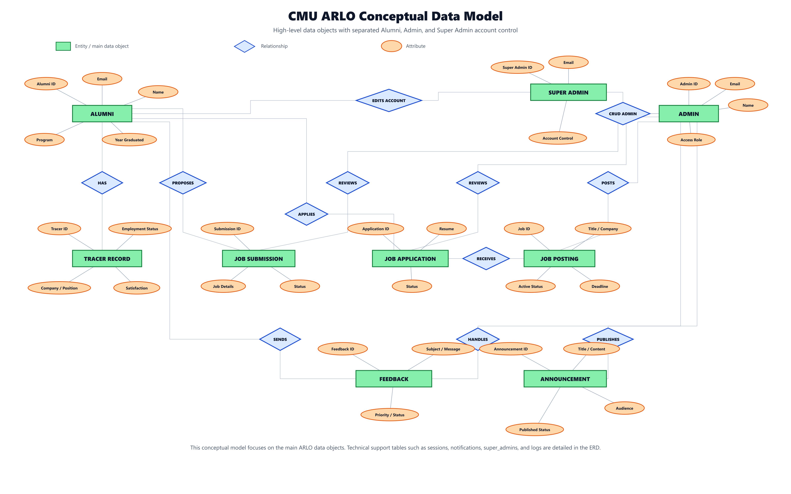

# ARLO Conceptual Data Model

This data model is a high-level view of the main data objects, their key attributes, and the relationships between them before translating the design into the detailed ERD. The latest model separates **Alumni**, **Admin**, and **Super Admin** as distinct system actors so their responsibilities are easier to understand.

## Notation

- Green rectangles represent entities or main data objects.
- Orange ovals represent key attributes.
- Blue diamonds represent relationships between entities.
- The detailed cardinalities are shown in the ERD.

## Super Admin Update

- **Alumni** represents graduate accounts and CSV-imported roster records stored in the `users` table.
- **Admin** represents regular administrator accounts stored in the `admins` table.
- **Super Admin** represents the highest account-control authority stored in the separate `super_admins` table.
- The **manages admin accounts** relationship shows that the Super Admin can create, view, update, and delete administrator accounts.
- The **edits alumni accounts** relationship shows that the Super Admin can correct or update alumni account details when account-level changes are required.
- In the detailed ERD, Super Admin is stored separately from regular administrators through the `super_admins` table.

## Suggested Figure Caption

**Figure X. Conceptual Data Model of the CMU ARLO Web-Based Tracer and Employment Analytics System**
