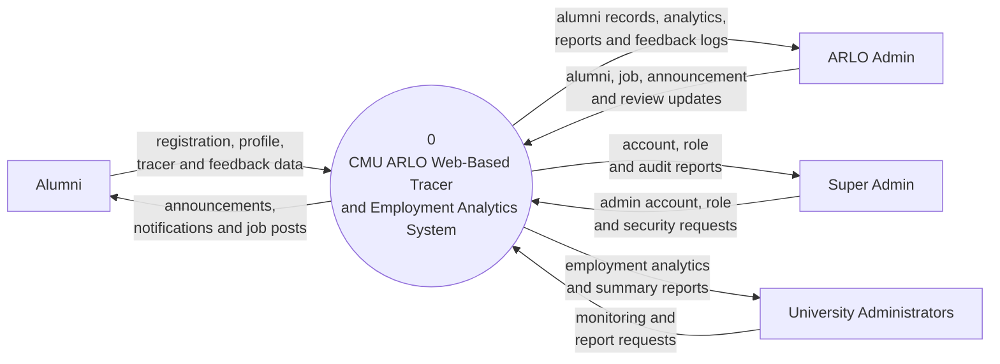
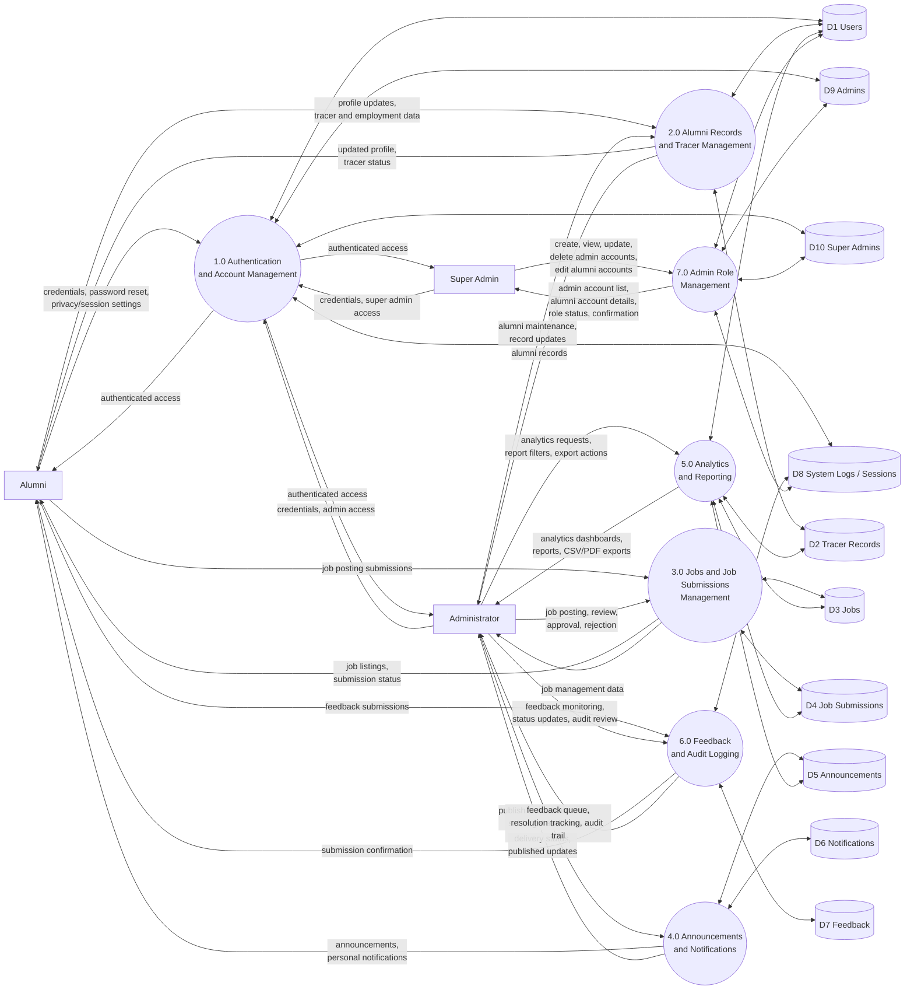

# ARLO Data Flow Diagram (DFD)

This DFD is aligned with the workflow of the **A Web-Based Tracer and Employment Analytics System for Alumni Relation and Linkages Office**.

## Context Diagram (Level 0)

## Level 1 DFD

## Suggested Paper Labels

- **Figure X. Context Diagram of the Proposed System**
- **Figure Y. Level 1 Data Flow Diagram of the Proposed System**

## Short Explanation For Your Paper

The context diagram shows the interaction of the main external actors, namely the alumni, ARLO admin, super admin, and university administrators, with the proposed web-based tracer and employment analytics system. The system receives inputs such as registration details, profile updates, tracer information, feedback, job posting submissions, administrative review actions, report requests, and super-admin account and role requests. In return, it provides outputs such as announcements, notifications, job posts, alumni records, analytics, reports, feedback logs, account and role reports, and audit reports.

The Level 1 DFD further breaks down the system into seven major processes: authentication and account management, alumni records and tracer management, jobs and job submissions management, announcements and notifications, analytics and reporting, feedback and audit logging, and admin role management. Authentication includes secure login controls such as password reset and session-aware account access. The Super Admin process is separated from regular administrator operations to show that only the Super Admin can create, view, update, and delete administrator accounts, assign administrator access roles, and edit alumni account details when account correction is required. These account changes are connected to the users, admins, super admins, and system logs data stores for accountability.
