# ARLO Latest System Diagrams

These diagrams reflect the current implemented system structure as of May 12, 2026.

## Diagram Files

| Diagram | Mermaid Source | HD SVG | HD PNG |
|---|---|---|---|
| Full Entity Relationship Diagram | `arlo-erd-full.mmd` | `arlo-erd-full.svg` | `arlo-erd-full-hd.png` |
| Full Conceptual Data Model | `arlo-data-model-full.mmd` | `arlo-data-model-full.svg` | `arlo-data-model-full-hd.png` |
| Full Use Case Diagram | `arlo-use-case-full.mmd` | `arlo-use-case-full.svg` | `arlo-use-case-full-hd.png` |
| Full System Flowchart | `arlo-system-flowchart-full.mmd` | `arlo-system-flowchart-full.svg` | `arlo-system-flowchart-full-hd.png` |

## Preview

### Full Entity Relationship Diagram

### Full Conceptual Data Model

### Full Use Case Diagram

### Full System Flowchart

## Design Notes

- Alumni records are stored in the `users` table.
- Regular administrator accounts are stored in the `admins` table.
- Super Admin accounts are stored in a separate `super_admins` table.
- The ERD separates administrator operations from Super Admin account-control responsibilities.
- CSV-imported alumni records are marked through `users.is_batch_imported = true`.
- A CSV-only record becomes a registered alumni account when the alumnus passes roster verification and email code verification.
- Analytics should separate total roster records, registered alumni, and not-registered CSV-only records so reports are not confused with unclaimed imported data.

## Suggested Figure Captions

- **Figure X. Full Entity Relationship Diagram of the Web-Based Tracer and Employment Analytics System**
- **Figure X. Full Conceptual Data Model of the Web-Based Tracer and Employment Analytics System**
- **Figure X. Use Case Diagram of the Web-Based Tracer and Employment Analytics System**
- **Figure X. System Flowchart of the Web-Based Tracer and Employment Analytics System**
