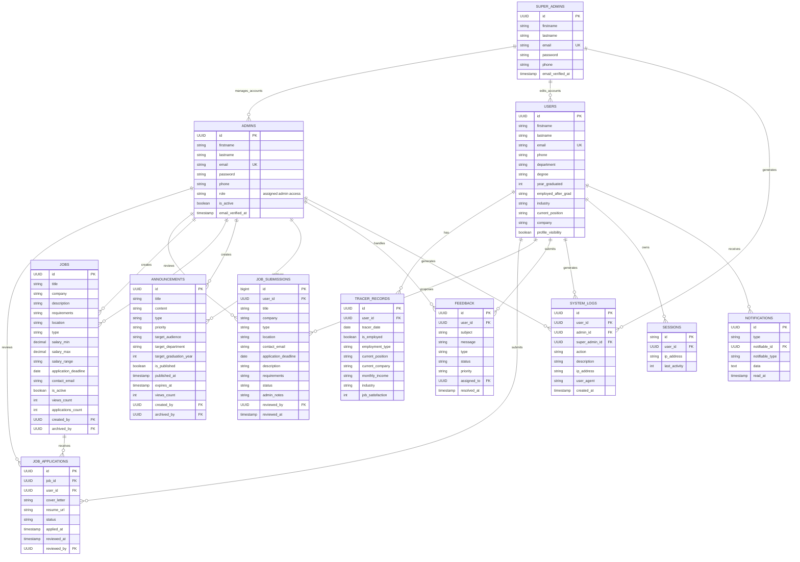

# ARLO Entity Relationship Diagram (ERD)

This ERD presents the separated account design of the **A Web-Based Tracer and Employment Analytics System for Alumni Relation and Linkages Office** project. Alumni accounts, regular administrator accounts, and Super Admin accounts are modeled as separate entities.

## Main Relationship Notes

- One `USER` can have many `TRACER_RECORDS`.
- One `USER` can apply to many `JOBS` through `JOB_APPLICATIONS`.
- One `JOB` can receive many `JOB_APPLICATIONS`.
- One `USER` represents an alumni account and can submit many proposed job posts through `JOB_SUBMISSIONS`.
- One `ADMIN` represents a regular administrative account stored in the `admins` table. Its `role` field describes the assigned administrator access level.
- One `SUPER_ADMIN` represents a separate super administrator account stored in the `super_admins` table.
- One `SUPER_ADMIN` can create, update, delete, and assign access roles to many `ADMIN` accounts.
- One `SUPER_ADMIN` can edit `USER` account details when account correction or account control is required.
- Regular `ADMIN` accounts can manage alumni records, tracer-related records, job postings, announcements, feedback, reports, and audit logs according to granted access.
- One `USER` can receive many `NOTIFICATIONS`.
- One `USER` can submit many `FEEDBACK` records, while an `ADMIN` may be assigned to handle feedback.
- `SYSTEM_LOGS` and `SESSIONS` support monitoring and access tracking.

## Suggested Use In Paper

You can label this as:

**Figure X. Entity Relationship Diagram of the Proposed Web-Based Tracer and Employment Analytics System**
