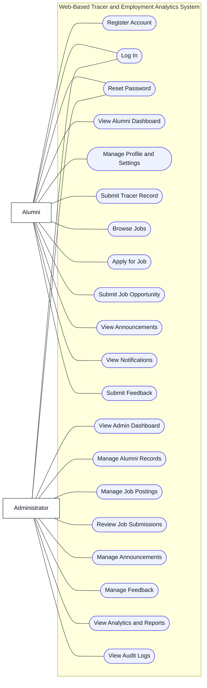

d# ARLO Use Case Diagram

This use case diagram is aligned with the workflow of the **Web-Based Tracer and Employment Analytics System for the Alumni Relations and Linkages Office**.

## Suggested Paper Label

- **Figure X. Use Case Diagram of the Proposed Web-Based Tracer and Employment Analytics System for the Alumni Relations and Linkages Office**

## Short Explanation For Your Paper

The use case diagram presents the main interactions between the two primary actors, namely the alumni and the administrator, and the proposed web-based tracer and employment analytics system. The alumni actor can register an account, log in, reset a password, manage a profile and settings, submit tracer records, browse and apply for jobs, submit job opportunities, view announcements and notifications, and send feedback. On the other hand, the administrator actor can log in, reset a password, access the admin dashboard, manage alumni records, manage job postings, review job submissions, manage announcements, monitor feedback, view analytics and reports, and review audit logs.
