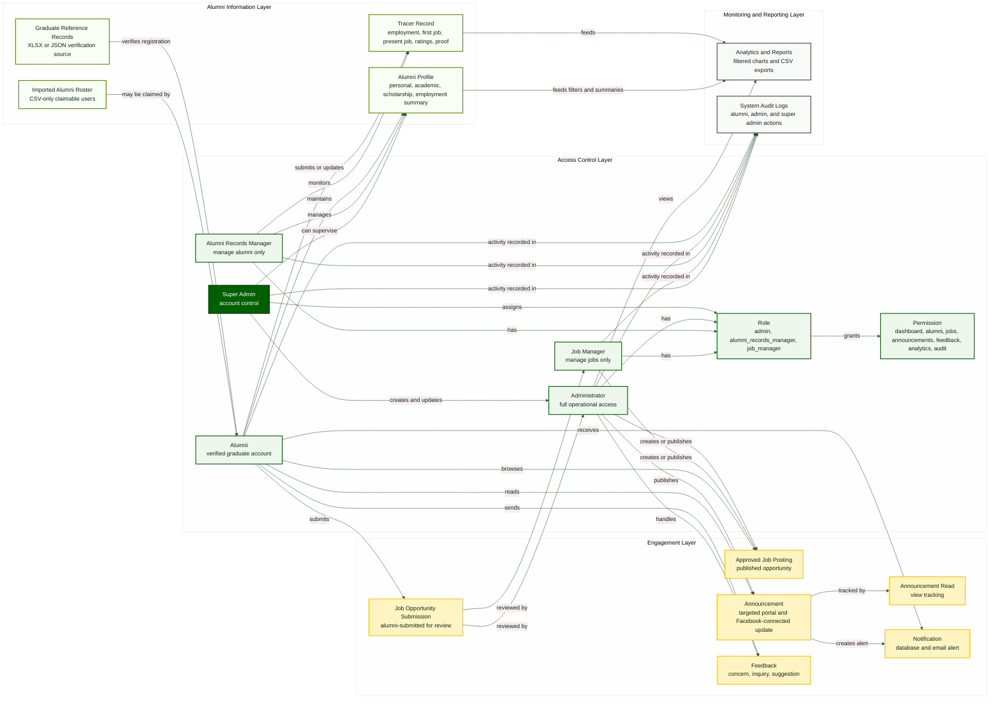
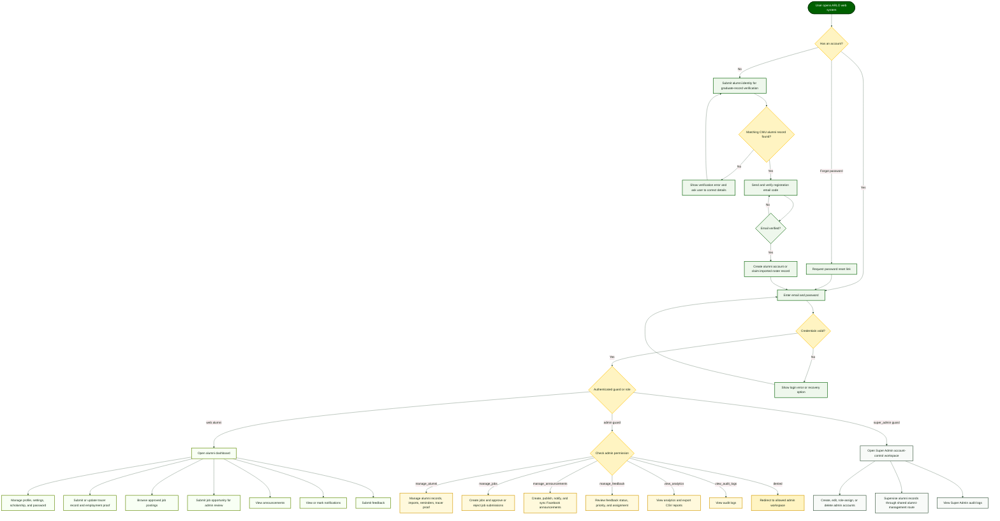

# Paper Alignment Notes and Current Diagrams

This file aligns the manuscript with the current Laravel implementation in this repository. The current system is a tracer, alumni record, job posting, announcement, notification, feedback, analytics, audit log, and admin account-control platform.

Important source-of-truth note: the live PostgreSQL database can now be inspected after enabling the PHP `pdo_pgsql`, `pgsql`, `mbstring`, and `intl` extensions. The live database is reachable, but it is two migrations behind the latest code. The diagrams in this file represent the current Laravel code and pending migration design. If the paper must match the exact live database before running pending migrations, remove the RBAC tables from the ERD and describe role access through `admins.role` only.

Live database inspected: PostgreSQL 18.2, connection `pgsql`, database `cmu_arlo_db`, host `127.0.0.1`, port `5432`. The live database currently has 17 tables and about 3.43 MB total size.

## Source Files Reviewed

- `routes/web.php`
- `config/auth.php`
- `app/Models/User.php`
- `app/Models/Admin.php`
- `app/Models/SuperAdmin.php`
- `app/Models/Role.php`
- `app/Models/Permission.php`
- `app/Models/TracerRecord.php`
- `app/Http/Controllers/AuthController.php`
- `app/Http/Controllers/Alumni/*`
- `app/Http/Controllers/Admin/*`
- `app/Http/Controllers/SuperAdmin/*`
- `app/Http/Middleware/*`
- `app/Notifications/*`
- `app/Services/*`
- `database/migrations/*`
- Live PostgreSQL database through `php artisan db:show --counts`
- Live table details through `php artisan db:table users`, `admins`, `super_admins`, `tracer_records`, `jobs`, `job_submissions`, `announcements`, `announcement_reads`, `notifications`, `feedback`, `system_logs`, and `sessions`

## Main Finding

The paper is mostly aligned with the implemented system, but several parts still describe old or partial designs. The biggest correction is this:

The current system does not support direct alumni job applications. It supports approved job postings and alumni-submitted job opportunities that administrators review, approve, or reject.

The second correction is that the codebase contains the RBAC migration design, but the live database has not applied the RBAC migrations yet. The current live admin access table is `admins` with a `role` column. After running the pending migrations, the database should also have `roles`, `permissions`, `admin_role`, and `role_permission`.

## Live Database Snapshot

Current live tables and row counts:

| Table | Rows | Notes |
| --- | ---: | --- |
| `users` | 550 | Alumni accounts and imported/claimable alumni records |
| `tracer_records` | 101 | Submitted tracer records with extended employment and satisfaction fields |
| `admins` | 1 | Regular administrator account table with `role` column |
| `super_admins` | 1 | Separate Super Admin account table |
| `jobs` | 2 | Approved/admin-created job postings |
| `job_submissions` | 1 | Alumni-submitted job opportunities for review |
| `announcements` | 118 | Portal announcements with targeting and Facebook sync fields |
| `announcement_reads` | 2 | Announcement read receipts |
| `notifications` | 2,353 | Laravel polymorphic notification records |
| `feedback` | 1 | Alumni feedback records |
| `system_logs` | 185 | Audit/activity log records |
| `sessions` | 8 | Laravel session records |
| `password_reset_tokens` | 1 | Password recovery tokens |
| `cache` | 15 | Laravel cache records |
| `cache_locks` | 0 | Laravel cache lock records |
| `failed_jobs` | 0 | Failed queue job records |
| `migrations` | 40 | Migration history records |

Pending migrations in the live database:

- `2026_05_13_000005_add_scoped_admin_roles`
- `2026_05_14_000002_create_admin_rbac_tables`

Live database confirmations:

- `job_applications` is not present in the live database.
- `jobs.applications_count` is not present in the live database.
- `feedback.admin_notes` is not present in the live database.
- `job_submissions.admin_notes` is present and belongs to administrator review notes for submitted job opportunities.
- `notifications` uses Laravel's polymorphic structure through `notifiable_type` and `notifiable_id`.
- `system_logs` links to `admins` and `super_admins`; it does not currently show a database foreign key for `user_id` in the Artisan table output.

Live aggregate checks:

- `users`: 101 non-imported alumni account records and 449 batch-imported alumni roster records.
- `admins`: 1 account with role `admin`.
- `super_admins`: 1 account.
- `tracer_records`: 80 marked presently employed and 21 marked not presently employed.
- `jobs`: 2 active job postings.
- `job_submissions`: 1 approved alumni-submitted job opportunity.
- `announcements`: 109 published and 9 unpublished records.
- `feedback`: 1 open, medium-priority feedback record.
- `notifications`: 2,341 unread and 12 read records.

## What We Need To Change, How, And Why

| Part to Change | How to Change It | Why |
| --- | --- | --- |
| Job module wording | Replace `job applications`, `apply for jobs`, and `applications_count` with `job postings`, `alumni-submitted job opportunities`, and `job submissions for review`. | The current migrations remove `job_applications` and `jobs.applications_count`. The app uses `job_submissions` and `jobs`. |
| ERD | Use the updated ERD in `docs/arlo-current-erd.mmd` for the final code/migration design. Include `roles`, `permissions`, `admin_role`, and `role_permission` only after applying the pending RBAC migrations. Remove `job_applications`. Remove `feedback.admin_notes`. | The current code has RBAC migrations and no direct job application table. The live DB is currently two migrations behind. Feedback has status, priority, assignee, and resolved time, but no admin notes column. |
| Conceptual data model | Use the updated model in `docs/arlo-current-data-model.mmd`. Add graduate reference records, imported roster records, role, and permission. | Registration verification and batch import are real system features. RBAC is now implemented through roles and permissions. |
| Use case diagram | Use the updated use case file in `docs/arlo-current-use-case.mmd`. Add email verification, employment proof, roster import, Facebook sync, scoped admin permissions, and Super Admin account control. | These use cases exist in routes/controllers and are visible in the implemented system. |
| System flowchart | Add the new flowchart in `docs/arlo-current-system-flowchart.mmd`. | The paper needs a current flow showing alumni verification, email verification, guard-based login, admin permission checks, and Super Admin routing. |
| Admin roles in paper | Explain Administrator, Alumni Records Manager, Job Manager, and Super Admin. State that regular admin roles are backed by role and permission tables. | The current system has `admins`, `super_admins`, `roles`, `permissions`, `admin_role`, and `role_permission`. |
| Email notification wording | Change text saying the system does not send automatic emails. Say email delivery is available when mail settings are configured. | The system sends registration email codes, password reset links, announcement notifications, direct admin notices, and job submission review updates through mail where configured. |
| Feedback narrative | Do not say feedback has admin reply notes unless that feature is added. Say admins can review, filter, assign, prioritize, update status, and mark resolved or closed. | The implemented `feedback` table has no `admin_notes` field. |
| Archive/delete wording | Avoid promising that normal job and announcement deletion always archives records. Use `remove/delete` unless an archive workflow is implemented. | `AdminJobController` and `AdminAnnouncementController` delete normal records. `archived_at` exists in schema, and Facebook sync may mark unavailable Facebook announcements, but normal UI deletion is hard delete. |
| Laravel reference | Use Laravel 12 documentation, or write the reference as Laravel Documentation without `13.x`. | `composer show laravel/framework` reports Laravel `v12.48.1`. |
| ARLO/OARL naming | Choose one acronym and make paper/UI wording consistent. | The paper uses ARLO, while code and UI text often use OARL/CMU OARL. If official office name is Office of Alumni Relations and Linkages, use OARL. If the paper title must remain ARLO, update UI/email text later. |
| Stale support docs | Regenerate or update `database_schema.sql`, `laravel_migrations.sql`, `analytics_queries.sql`, `sample_data.sql`, `README.md`, and older diagram files if they will be submitted. | These files still contain old job-application wording or stale schema details. |
| Data dictionary support tables | Correct `cache_locks` to `key`, `owner`, and `expiration`. Keep `migrations` separate with `id`, `migration`, and `batch`. | Current Laravel cache migration uses those fields. |
| Figure/table numbering | Renumber Chapter IV and Chapter V figures/tables sequentially. | The paper repeats several section, figure, and table numbers. |

## Updated Diagram Files

Use these Mermaid source files as the current diagrams:

- ERD: `docs/arlo-current-erd.mmd`
- Conceptual Data Model: `docs/arlo-current-data-model.mmd`
- Use Case Diagram: `docs/arlo-current-use-case.mmd`
- System Flowchart: `docs/arlo-current-system-flowchart.mmd`

CMU color note: use Central Mindanao University's green and gold identity for diagram styling. The current palette uses deep green `#006000`, darker green `#003300`, gold `#FFC000`, soft green `#EEF7EC`, soft gold `#FFF4C2`, and dark readable text `#102414`.

## Updated ERD Summary

The updated ERD has these main groups:

- Alumni records: `users`, `tracer_records`, `announcement_reads`, `notifications`, `feedback`, `job_submissions`
- Admin records: `admins`, `roles`, `permissions`, `admin_role`, `role_permission`
- Super Admin records: `super_admins`
- Engagement records: `jobs`, `job_submissions`, `announcements`, `announcement_reads`, `feedback`, `notifications`
- Monitoring/support records: `system_logs`, `sessions`, `password_reset_tokens`, `failed_jobs`, `cache`, `cache_locks`, `migrations`

Key ERD corrections:

- `users` represents alumni accounts and imported alumni roster records.
- `admins` represents regular administrator accounts.
- `super_admins` represents the separate Super Admin account table.
- `roles` and `permissions` support scoped administrator access after the pending RBAC migrations are applied.
- `job_submissions` represents alumni-submitted job opportunities.
- `jobs` represents approved or administrator-created job postings.
- `job_applications` should not be shown in the current ERD.
- `notifications` uses Laravel polymorphic fields: `notifiable_type` and `notifiable_id`.
- `feedback` has no `admin_notes` column in the current implementation.

## Updated Conceptual Data Model

## Updated Use Case Diagram

```mermaid
%%{init: {"theme": "base", "flowchart": {"curve": "basis", "nodeSpacing": 40, "rankSpacing": 70}, "themeVariables": {"background": "#ffffff", "primaryColor": "#eef7ec", "primaryBorderColor": "#006000", "primaryTextColor": "#102414", "lineColor": "#35543b", "fontFamily": "Inter, Arial, sans-serif", "fontSize": "16px"}}}%%
flowchart LR
    Alumni["Actor: Alumni"]
    Admin["Actor: Administrator"]
    AlumniMgr["Actor: Alumni Records Manager"]
    JobMgr["Actor: Job Manager"]
    SuperAdmin["Actor: Super Admin"]

    subgraph System["Web-Based Tracer and Employment Analytics System"]
        direction TB

        subgraph AlumniCases["Alumni Use Cases"]
            direction TB
            A1(["Register and verify alumni record"])
            A2(["Verify registration email code"])
            A3(["Log in"])
            A4(["Reset password"])
            A5(["View alumni dashboard"])
            A6(["Manage profile and settings"])
            A7(["Submit or update tracer record"])
            A8(["Upload or view employment proof"])
            A9(["Browse approved job postings"])
            A10(["Submit job opportunity for review"])
            A11(["View announcements"])
            A12(["View and mark notifications"])
            A13(["Submit feedback"])
            A14(["Delete own account"])
        end

        subgraph AdminCases["Administrator Use Cases"]
            direction TB
            B1(["Log in"])
            B2(["Reset password"])
            B3(["View admin dashboard"])
            B4(["Manage alumni records"])
            B5(["Import alumni roster"])
            B6(["Notify selected alumni"])
            B7(["Monitor tracer submissions"])
            B8(["Download employment proof"])
            B9(["Manage job postings"])
            B10(["Review alumni job submissions"])
            B11(["Manage announcements"])
            B12(["Sync or publish Facebook announcements"])
            B13(["Send announcement notifications"])
            B14(["Manage feedback status and assignment"])
            B15(["View analytics"])
            B16(["Export CSV reports"])
            B17(["View audit logs"])
        end

        subgraph ScopedCases["Scoped Admin Use Cases"]
            direction TB
            C1(["Manage alumni records only"])
            C2(["Import alumni roster only"])
            C3(["Notify alumni from records only"])
            C4(["Manage job postings only"])
            C5(["Approve or reject job submissions only"])
        end

        subgraph SuperCases["Super Admin Use Cases"]
            direction TB
            D1(["Log in"])
            D2(["Reset password"])
            D3(["View account-control workspace"])
            D4(["Create administrator account"])
            D5(["Edit administrator account"])
            D6(["Assign or update administrator role"])
            D7(["Remove administrative access"])
            D8(["Supervise alumni records"])
            D9(["View Super Admin audit logs"])
        end
    end

    Alumni --- A1
    Alumni --- A2
    Alumni --- A3
    Alumni --- A4
    Alumni --- A5
    Alumni --- A6
    Alumni --- A7
    Alumni --- A8
    Alumni --- A9
    Alumni --- A10
    Alumni --- A11
    Alumni --- A12
    Alumni --- A13
    Alumni --- A14

    Admin --- B1
    Admin --- B2
    Admin --- B3
    Admin --- B4
    Admin --- B5
    Admin --- B6
    Admin --- B7
    Admin --- B8
    Admin --- B9
    Admin --- B10
    Admin --- B11
    Admin --- B12
    Admin --- B13
    Admin --- B14
    Admin --- B15
    Admin --- B16
    Admin --- B17

    AlumniMgr --- C1
    AlumniMgr --- C2
    AlumniMgr --- C3
    JobMgr --- C4
    JobMgr --- C5

    SuperAdmin --- D1
    SuperAdmin --- D2
    SuperAdmin --- D3
    SuperAdmin --- D4
    SuperAdmin --- D5
    SuperAdmin --- D6
    SuperAdmin --- D7
    SuperAdmin --- D8
    SuperAdmin --- D9

    A1 -. "includes" .-> A2
    A7 -. "may include" .-> A8
    A10 -. "requires admin review" .-> B10
    B10 -. "may create approved posting" .-> B9
    B11 -. "may trigger" .-> B13
    B11 -. "may use" .-> B12
    B16 -. "extends" .-> B15
    D4 -. "includes" .-> D6
    D5 -. "may include" .-> D6
    D5 -. "may extend to" .-> D7

    classDef actor fill:#006000,stroke:#003300,stroke-width:2px,color:#ffffff;
    classDef alumni fill:#eef7ec,stroke:#006000,stroke-width:2px,color:#102414;
    classDef admin fill:#fff4c2,stroke:#ffc000,stroke-width:2px,color:#102414;
    classDef scoped fill:#f8fff4,stroke:#5f8800,stroke-width:2px,color:#102414;
    classDef super fill:#f8faf8,stroke:#35543b,stroke-width:2px,color:#102414;

    class Alumni,Admin,AlumniMgr,JobMgr,SuperAdmin actor;
    class A1,A2,A3,A4,A5,A6,A7,A8,A9,A10,A11,A12,A13,A14 alumni;
    class B1,B2,B3,B4,B5,B6,B7,B8,B9,B10,B11,B12,B13,B14,B15,B16,B17 admin;
    class C1,C2,C3,C4,C5 scoped;
    class D1,D2,D3,D4,D5,D6,D7,D8,D9 super;
```

## Updated System Flowchart

## Chapter-By-Chapter Paper Cleanup

### Chapter I

- Keep the system title and general problem, but make acronym usage consistent: ARLO or OARL.
- In objectives and scope, use `job postings and alumni-submitted job opportunities` instead of `job applications`.
- Add that email-based registration verification and password recovery are supported when mail settings are configured.
- Clarify administrator roles: Administrator, Alumni Records Manager, Job Manager, and Super Admin.

### Chapter II

- Fix duplicated numbering in related studies.
- Change `We emphasized` to `They emphasized` when referring to other authors.
- Keep Virutkar et al. as the study supporting job opportunity and career-assistance features.

### Chapter III

- Change Laravel reference to Laravel 12 / Laravel documentation. The installed version is `v12.48.1`.
- Update notification support to mention both database notifications and email notifications when mail is configured.
- Keep Facebook Page publishing/synchronization as configuration-dependent.

### Chapter IV

- Fix the section numbering:
  - `4.4.1 System Flowchart`
  - `4.4.2 Data Flow Diagram Level 0`
  - `4.4.3 Conceptual Data Model`
  - `4.4.4 Entity Relationship Diagram`
  - `4.4.5 Data Dictionary`
  - `4.4.6 Use Case Diagram`
- Move Super Admin role management out of Alumni Functional Requirements.
- Add a separate Super Admin functional requirements table.
- Add RBAC tables to ERD and data dictionary after applying pending migrations: `roles`, `permissions`, `admin_role`, `role_permission`.
- Remove `job_applications` and `applications_count`.
- Remove `feedback.admin_notes` unless that field is implemented later.
- Correct `cache_locks`.
- Keep `notifications` as a polymorphic Laravel table.

### Chapter V

- Keep the module result descriptions, but remove any text saying alumni apply for jobs.
- Describe analytics using the current chart groups:
  - employment trends
  - traced graduates
  - industry distribution
  - employability rate
  - global distribution
  - reasons for unemployment
  - user growth
  - job opportunity submissions
  - alumni by college
  - employment status
  - graduation year trends
  - feedback categories
  - curriculum relevance
  - time to first job
  - present employment status
  - teaching feedback
  - university facilities
  - overall experience
  - industry growth

### Chapter VI

- Keep the recommendation that future versions may add a real job application workflow.
- Add that stronger deployment documentation should include a refreshed schema dump generated from current migrations.
- Add that mail delivery depends on correct SMTP/Gmail/provider configuration.

## System Parts That Do Not Need Application Code Changes Right Now

- Alumni registration and graduate-record verification are implemented.
- Registration email verification is implemented.
- Alumni profile, scholarship, tracer, employment proof, announcements, notifications, jobs, job submissions, and feedback are implemented.
- Admin alumni management, imports, jobs, announcements, Facebook sync, feedback, analytics, CSV export, and audit logs are implemented.
- Super Admin account control and role assignment are implemented.
- RBAC support exists in the code and pending migrations. The live database still needs `php artisan migrate` before the role and permission tables exist.

## Optional Future System Changes

These are not required for paper alignment, but they are useful if the adviser wants the system to match some older paper promises exactly:

- Add a real job application workflow only if ARLO wants alumni to apply through the portal.
- Add `feedback.admin_notes` or a `feedback_responses` table only if ARLO wants written admin replies stored in the system.
- Change normal job and announcement deletion into soft archive behavior if the paper must promise archive instead of delete.
- Standardize all UI/email naming to either ARLO or OARL.
- Regenerate SVG/PNG diagram images from the updated Mermaid files before inserting final figures into the manuscript.
